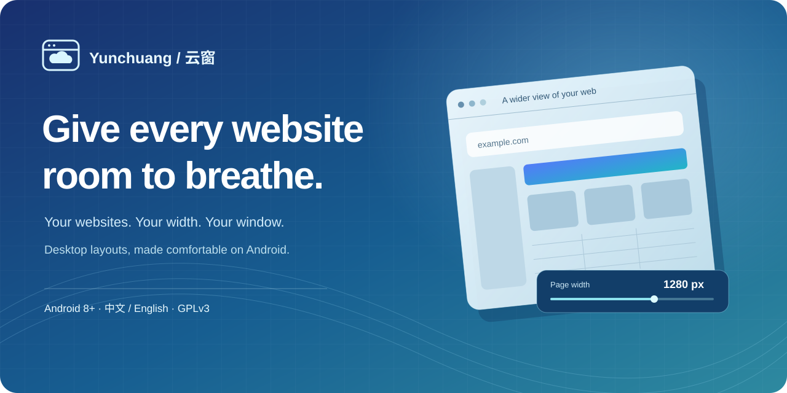
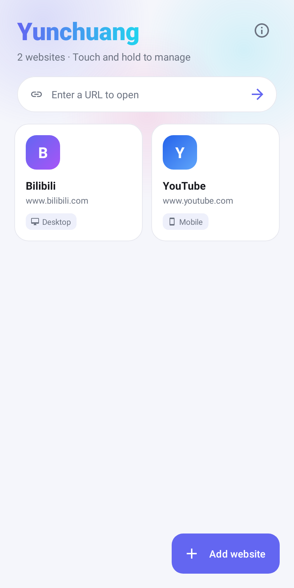

<p align="center"></p>

<p align="center">
  <a href="README.zh-CN.md">简体中文</a> · <b>English</b> · <a href="https://github.com/collapsingsea/yunchuang/releases">Download APK</a> · <a href="CHANGELOG.md">Changelog</a>
</p>
<p align="center">
  
  
  <a href="LICENSE"></a>
  
</p>

### A small window for websites that need more space

Old academic portals, wide tables and desktop dashboards can be awkward on a phone. Yunchuang gives each website its own page width, user agent, zoom and orientation settings, then fits the result onto your screen.

Save your websites as colorful cards. Pin them to your home screen. Open them in their own browsing windows.

> Yunchuang opens **websites** in Android WebView. It does not resize or launch other Android apps.

### See it in action

<p align="center"></p>
<p align="center"><sub>English home screen rendered from the Android layout with public example websites. The APK follows your system language.</sub></p>

### Make the web fit you

| Control | What you can do |
| --- | --- |
| Page width | Set 320–2560 px with presets, a slider or an exact value. Mobile mode can use the device viewport. |
| Display mode | Use desktop, mobile or custom User-Agent settings for each website. |
| Zoom and orientation | Fit the whole page, set an initial zoom, pinch to zoom, and choose portrait or landscape. |
| Website collection | Reorder cards, pin favorites, add home-screen shortcuts, and open links shared from other apps. |
| Floating controls | Navigate, reload and change settings. Collapse the toolbar to a draggable button or hide it for the session. |
| Advanced settings | Configure text size, JavaScript, image loading, cookies and keep-screen-on behavior. |
| Fingerprint and proxy | Configure browser-property overrides and an HTTP/SOCKS5 proxy for browsing a website. |
| Languages and theme | Chinese and English follow the system language. Light and dark themes follow the system appearance. |

### Download and get started

1. Download the latest APK from [Releases](https://github.com/collapsingsea/yunchuang/releases).
2. Install it on Android 8.0 or later. Allow installation from your browser or file manager when Android asks.
3. Tap **Add website**, enter a URL, choose a display mode and save.
4. For a wide desktop page, start with **1280 px** and **Fit the page to the screen**. Adjust the width while browsing if needed.

**Upgrading from 2.3.1 or earlier:** those APKs used a debug signing key. The first production-signed release requires uninstalling the debug build first, which removes its saved websites and settings. Later production releases will use the same production key for in-place updates.

### How it works

Desktop mode combines a desktop User-Agent, WebView’s wide viewport, injected viewport/layout rules and an initial scale based on the screen width. Mobile mode uses the device viewport by default. Each saved website retains its own configuration.

Fingerprint overrides change selected browser-visible properties; they do not guarantee anonymity or defeat every fingerprint detector. Proxy settings apply to the WebView process. Websites share the app’s WebView cookie store; saved cards are not isolated browser profiles. Direct mode bypasses the system HTTP proxy, but cannot bypass a VPN/TUN connection. SOCKS5 authentication depends on WebView support.

Browser sign-in opens the website in an external browser tab. Its session and Yunchuang’s display, fingerprint and proxy settings are not shared between the two browsers.

### Build from source

Requirements: **JDK 17**, **Android SDK 34**. The project includes the **Gradle 8.7** wrapper and uses Android Gradle Plugin **8.5.2**.

Open the project in Android Studio, or set `ANDROID_HOME` to your SDK directory and run:

```sh
./gradlew assembleDebug
./gradlew testDebugUnitTest lintDebug
```

On Windows, use `gradlew.bat`. The debug APK is written to `app/build/outputs/apk/debug/`.

```sh
./gradlew assembleRelease
```

This produces an unsigned release APK. Sign it with your own private key before distribution. Signing keys and credentials are not part of this repository.

### Version history

[English changelog](CHANGELOG.md) · [中文更新记录](CHANGELOG.zh-CN.md)

The detailed 2.3.1 fix list survives in the original project notes. APKs for 2.2.0 and 2.3.0 also survive, but their individual release notes were not found; this repository does not invent them.

### License

Yunchuang is licensed under [GNU GPL v3.0](LICENSE). You may use, modify and redistribute it, including commercially, under that license. When distributing a covered derivative, provide the corresponding source under the GPL and retain the required notices. Dependencies retain their own licenses.
