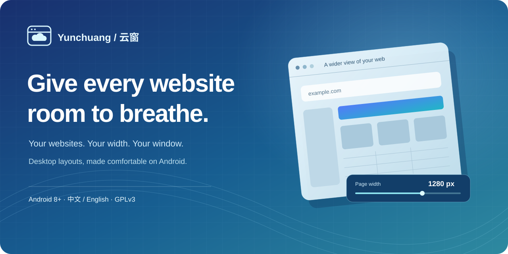
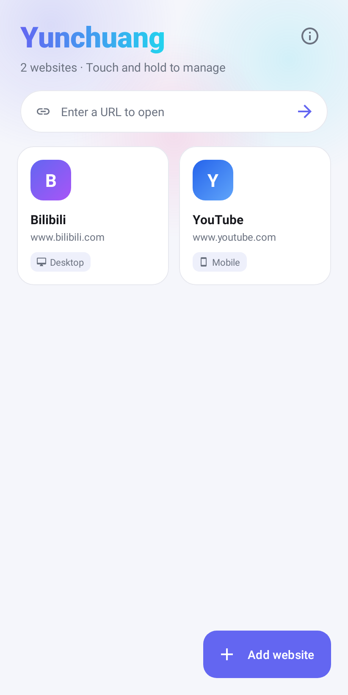

<p align="center"></p>

<p align="center"><b>简体中文</b> · <a href="README.md">English</a> · <a href="https://github.com/collapsingsea/yunchuang/releases">下载 APK</a> · <a href="CHANGELOG.zh-CN.md">更新记录</a></p>
<p align="center">
  
  
  <a href="LICENSE"></a>
  
</p>

### 把常用网站，装进一扇窗

教务系统的表格被挤成一团，电脑网站在手机上显示不全？云窗让每个网站拥有独立的页面宽度、浏览器标识、缩放和横竖屏设置，再把整页缩放到手机屏幕。

把常用网站收进彩色卡片，也可以添加到桌面，像应用一样一键打开。

> 云窗通过 Android WebView 打开**网站**，不用于调整其他安卓 App 的窗口尺寸。

### 界面预览

<p align="center"></p>
<p align="center"><sub>使用哔哩哔哩与 YouTube 的英文首页预览，由 Android 原生布局离线渲染。APK 随系统语言自动切换中英文。</sub></p>

### 一站一套设置

| 功能 | 你可以做什么 |
| --- | --- |
| 页面宽度 | 320–2560px，支持预设、滑杆和精确输入；手机版可使用设备实际视口。 |
| 显示模式 | 为各网站设置电脑版、手机版或自定义 User-Agent。 |
| 缩放与方向 | 整页适配屏幕、自定义初始缩放、双指缩放，独立选择横屏或竖屏。 |
| 网站收藏 | 拖动排序、置顶、添加桌面快捷方式，接收其他应用分享的链接。 |
| 悬浮工具栏 | 前进、后退、刷新和修改设置；可收起为拖动浮钮，也可在本次浏览中隐藏。 |
| 专业选项 | 文字缩放、JavaScript、图片、第三方 Cookie 和屏幕常亮。 |
| 指纹与代理 | 配置浏览器属性覆盖，以及 HTTP / SOCKS5 代理。 |
| 语言与主题 | 中英文随系统语言切换，浅色与深色随系统外观切换。 |

### 下载与使用

1. 在 [Releases](https://github.com/collapsingsea/yunchuang/releases) 下载最新 APK。
2. 安装到 Android 8.0 及以上设备；按系统提示允许浏览器或文件管理器安装应用。
3. 点击「添加网站」，填写网址，选择显示模式并保存。
4. 浏览宽表格时，可以先用「桌面版 + 1280px + 自动适应屏幕」，再按实际效果调整宽度。

**从 2.3.1 及更早版本升级：**旧安装包使用调试签名。首次安装正式签名版，需要先卸载旧版，原有网站收藏和设置会随之删除；之后的正式版沿用同一正式签名，可覆盖升级。

### 它是怎么做到的

桌面模式结合桌面 User-Agent、WebView 宽视口、注入 viewport 与布局规则，以及按屏幕宽度计算的初始缩放。手机版默认使用设备视口。每个网站的配置单独保存。

指纹功能覆盖部分网页可见属性，不保证匿名或绕过所有检测。代理设置实际作用于 WebView 进程；网站共享应用的 WebView Cookie 存储，卡片不等于相互隔离的浏览器账户。直连模式绕过系统 HTTP 代理，但不能绕过 VPN/TUN。SOCKS5 账号密码鉴权取决于 WebView 支持。

「浏览器登录」在外部浏览器标签页打开网站；登录状态不会同步回云窗，云窗的宽度、指纹和代理配置也不作用于外部标签页。

### 编译源码

需要 **JDK 17、Android SDK 34**。项目包含 **Gradle 8.7** Wrapper，使用 **AGP 8.5.2**。

用 Android Studio 打开项目，或设置 `ANDROID_HOME` 后运行：

```sh
./gradlew assembleDebug
./gradlew testDebugUnitTest lintDebug
```

Windows 使用 `gradlew.bat`。调试安装包位于 `app/build/outputs/apk/debug/`。

```sh
./gradlew assembleRelease
```

该命令生成未签名正式包，分发前请使用自己的私钥签名。签名密钥和凭据不包含在仓库中。

### 历史更新

[中文更新记录](CHANGELOG.zh-CN.md) · [English changelog](CHANGELOG.md)

原项目保留了详细的 2.3.1 修复记录，以及 2.2.0、2.3.0 安装包；这两个较早版本的逐版说明未找到，不补写未经证实的更新内容。

### 开源许可

项目采用 [GNU GPL v3.0](LICENSE)。可按许可证使用、修改和分发，包括商用；分发受 GPL 覆盖的衍生版本时，须按 GPL 提供对应源码，并保留必要声明。依赖库保留各自许可证。
